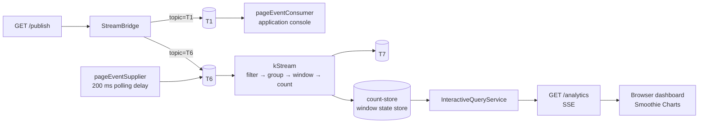
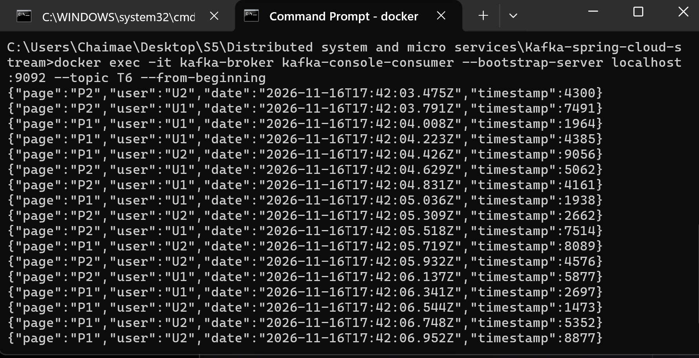
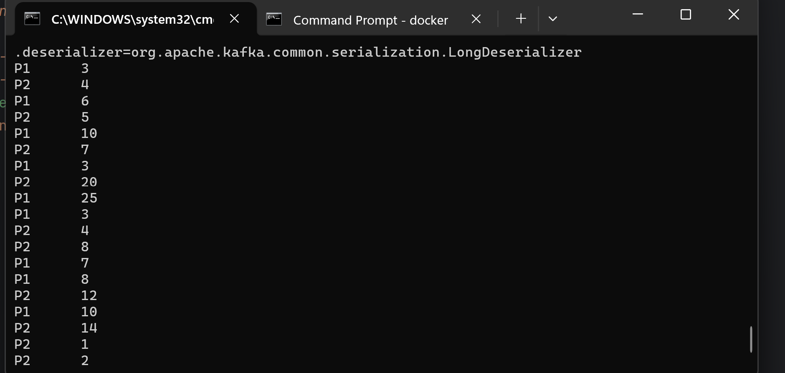
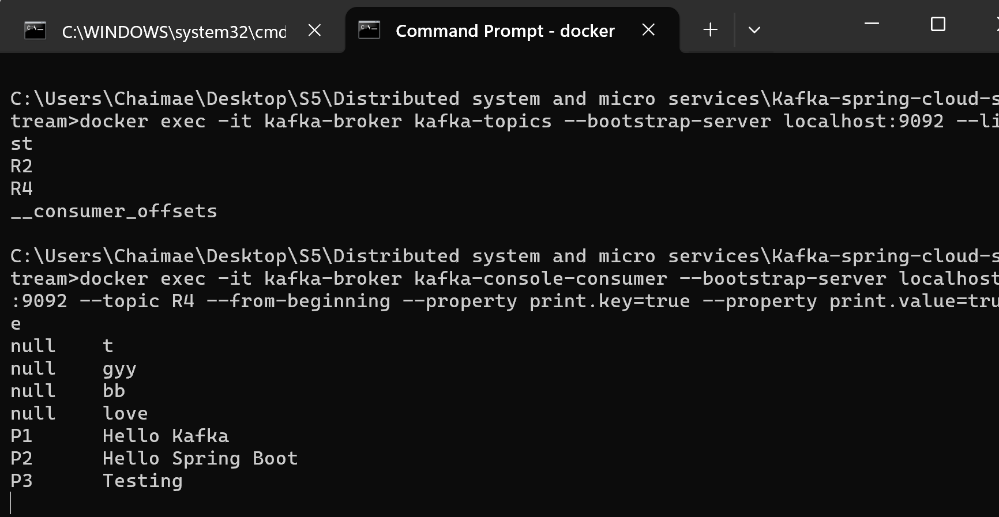

# Real-Time Page Analytics with Kafka & Spring Cloud Stream


An event-driven learning project that generates page events, processes them with **Kafka Streams**, and displays **live, per-page window counts** in a browser using **Server-Sent Events (SSE)**.

The application demonstrates Spring Cloud Stream's functional programming model, dynamic publishing with `StreamBridge`, stateful stream processing, and interactive queries against a Kafka Streams state store.


> **Scope:** a local, single-broker demonstration—not a production analytics platform. The chart shows changing window counts, not lifetime visit totals.

## Contents

- [Features](#features)
- [Architecture](#architecture)
- [Technology stack](#technology-stack)
- [Quick start](#quick-start)
- [HTTP API](#http-api)
- [Inspect Kafka from the command line](#inspect-kafka-from-the-command-line)
- [Processing and configuration](#processing-and-configuration)
- [Project structure](#project-structure)
- [Screenshots](#screenshots)
- [Build and tests](#build-and-tests)
- [Troubleshooting](#troubleshooting)
- [Limitations and next steps](#limitations-and-next-steps)

## Features

- **Publish events over HTTP** to a chosen destination using `StreamBridge`.
- **Consume page events** from topic `T1` and print them to the application console.
- **Generate synthetic events** for pages `P1` / `P2` and users `U1` / `U2`.
- **Filter and aggregate events** into non-overlapping, five-second windows.
- **Publish updated counts** to topic `T7`.
- **Query the `count-store` window store** without a separate database.
- **Stream analytics to the browser** approximately once per second through SSE.
- **Plot two live series** with Smoothie Charts, without a Node.js build step.

## Architecture



There are **two independent flows**:

1. **Basic messaging:** publish to `T1` → consume and print the event.
2. **Analytics:** generate or publish to `T6` → process and count → emit results to `T7` and expose the state store through `/analytics`.

Publishing to `T1` does **not** update the analytics chart.

## Technology stack

| Component | Version / implementation |
| --- | --- |
| Java | Target version **21** |
| Spring Boot | **4.1.1**, as declared in `pom.xml` |
| Spring Cloud BOM | **2025.1.3**, as declared in `pom.xml` |
| Messaging | Spring Cloud Stream Kafka binder |
| Stateful processing | Spring Cloud Stream Kafka Streams binder |
| Broker and coordination | Confluent Kafka and ZooKeeper images **7.3.0** |
| HTTP | Spring MVC and an SSE-producing `Flux` |
| Frontend | HTML, browser `EventSource`, Smoothie Charts **1.34.0** |
| Build | Maven Wrapper, configured for Maven **3.10.0** |

Kafka client and Streams dependency versions are resolved through Maven dependency management; the Docker image tag is not the Java client version.

## Quick start

### Prerequisites

- A **JDK 21 or newer**, with `JAVA_HOME` pointing to a JDK.
- **Docker Desktop** or Docker Engine with **Docker Compose v2**, using Linux containers.
- Available host ports **9092** and **8083**.
- Internet access for the initial Maven dependencies, Docker images, and the chart library loaded from a CDN.

Commands below use **Windows PowerShell**. On Linux/macOS, replace `.\mvnw.cmd` with `sh ./mvnw` and `curl.exe` with `curl`.

### 1. Clone the repository

```powershell
git clone https://github.com/CHAIMAEMOUHSSINE/kafka-streams.git
cd kafka-streams
```

If the project is already on your machine, open a terminal in its root directory—the directory containing `compose.yml` and `pom.xml`.

### 2. Start Kafka and ZooKeeper

```powershell
docker compose up -d
docker compose ps
```

Check the broker logs if it is still starting:

```powershell
docker compose logs -f broker
```

`depends_on` controls startup order, not broker readiness. Before starting Spring Boot, confirm that the broker answers:

```powershell
docker exec kafka-broker kafka-topics --bootstrap-server broker:29092 --list
```

The configured listeners are:

| Client location | Bootstrap address |
| --- | --- |
| Spring Boot running on your host | `localhost:9092` |
| Kafka tools inside the Compose network | `broker:29092` |
| ZooKeeper, inside the Compose network only | `zookeeper:2181` |

### 3. Prepare the application topics

These commands are safe to repeat for topics that already exist:

```powershell
docker exec kafka-broker kafka-topics --bootstrap-server broker:29092 --create --if-not-exists --topic T1 --partitions 1 --replication-factor 1
docker exec kafka-broker kafka-topics --bootstrap-server broker:29092 --create --if-not-exists --topic T6 --partitions 1 --replication-factor 1
docker exec kafka-broker kafka-topics --bootstrap-server broker:29092 --create --if-not-exists --topic T7 --partitions 1 --replication-factor 1
```

Kafka Streams also creates internal repartition/changelog topics as required.

### 4. Start the application

In a separate terminal:

```powershell
.\mvnw.cmd spring-boot:run
```

The HTTP server listens on **8083**. The supplier starts generating events automatically; you do not need to publish anything manually to populate the analytics pipeline.

### 5. Open the dashboard

Visit **http://localhost:8083/**.

The browser connects to `/analytics` and plots the `P1` and `P2` values. Allow a few seconds for stream initialization and the first window updates.

### Stop the local demo

Stop Spring Boot with `Ctrl+C`, then stop the containers:

```powershell
docker compose stop
```

This keeps the containers for a later restart. The Compose file does not define a named-volume persistence strategy; do not rely on container recreation preserving your demo data.

## HTTP API

### `GET /publish`

Create a `PageEvent` and send it to the destination specified by `topic`.

| Query parameter | Purpose | Example |
| --- | --- | --- |
| `name` | Page name stored in the event's `page` field | `P1` |
| `topic` | Destination passed to `StreamBridge.send` | `T1` or `T6` |

**Publish to the console consumer:**

```powershell
curl.exe "http://localhost:8083/publish?name=P1&topic=T1"
```

**Publish into the analytics pipeline:**

```powershell
curl.exe "http://localhost:8083/publish?name=P2&topic=T6"
```

Representative response:

```json
{
  "page": "P1",
  "user": "U1",
  "date": "2026-11-16T17:42:03.475Z",
  "timestamp": 430
}
```

The user, date, and numeric `timestamp` are generated by the controller. The response is the generated event, **not a consumer acknowledgement**: the controller does not return the result of `StreamBridge.send`.

> This demo publishes through a GET endpoint and accepts a dynamic destination. It has no explicit request validation or access control. A production API should use a validated POST request and restrict allowed destinations.

### `GET /analytics`

Returns an open-ended response with content type `text/event-stream`.

```powershell
curl.exe -N "http://localhost:8083/analytics"
```

Representative SSE messages:

```text
data:{"P1":8,"P2":11}

data:{"P1":10,"P2":12}
```

Values and JSON key order vary. Stop the connection with `Ctrl+C`.

The controller queries a **15-second lookback** in `count-store` approximately once per second. It initializes `P1` and `P2` to zero and replaces each value while iterating over matching windows.

**Important:** this is not a sum over the last 15 seconds. The code intends to display a recent window per page, but does not explicitly compare window timestamps to select the newest one. If the state store is unavailable, the exception is logged and the stream still returns the current map, which can contain zero values.

### `GET /`

Serves `src/main/resources/static/index.html`. The page uses `EventSource("/analytics")` and loads Smoothie Charts from cdnjs.

## Inspect Kafka from the command line

All commands below run the tools shipped inside the broker container.

### List topics

```powershell
docker exec kafka-broker kafka-topics --bootstrap-server broker:29092 --list
```

### Read raw events from `T6`

```powershell
docker exec -it kafka-broker kafka-console-consumer --bootstrap-server broker:29092 --topic T6 --from-beginning
```

Messages should be JSON representations of `PageEvent`.

### Read aggregated counts from `T7`

The output value is a Kafka `Long`, not a plain-text JSON number. Use the appropriate deserializer:

```powershell
docker exec -it kafka-broker kafka-console-consumer --bootstrap-server broker:29092 --topic T7 --from-beginning --property print.key=true --property print.value=true --property key.deserializer=org.apache.kafka.common.serialization.StringDeserializer --property value.deserializer=org.apache.kafka.common.serialization.LongDeserializer
```

Representative output:

```text
P1    3
P2    4
P1    6
P2    5
```

These are updates to window counts. They can decrease when a new window is represented.

### Send a controlled JSON event to `T6`

```powershell
docker exec -it kafka-broker kafka-console-producer --bootstrap-server broker:29092 --topic T6
```

Paste one JSON object per line:

```json
{"page":"P1","user":"U1","date":"2026-11-16T17:42:03.475Z","timestamp":500}
```

The event's Kafka record timestamp—not the sample date above—controls the window unless a custom timestamp extractor is configured. This project does not define one.

Use a separate terminal for the `T7` consumer or the dashboard. The automatic supplier remains active, so manually published events are mixed with generated traffic.

## Processing and configuration

### Event model

```java
public record PageEvent(String page, String user, java.util.Date date, long timestamp) {
}
```

| Field | Meaning in the current implementation |
| --- | --- |
| `page` | Page identifier; the supplier generates `P1` or `P2` |
| `user` | Synthetic user identifier, `U1` or `U2` |
| `date` | Event creation date |
| `timestamp` | Synthetic numeric value used by the filter—not an epoch timestamp |

The supplier generates `timestamp` values from **10 to 10,009**; the HTTP publisher generates values from **10 to 1,009**.

### Stream topology

The `kStream` function:

1. keeps events with `event.timestamp() > 100`;
2. replaces the key with the event's page;
3. maps the value to the numeric `timestamp`;
4. groups by the page key;
5. creates **five-second tumbling windows with no grace period**;
6. **counts events**, materializing the window store as `count-store`;
7. emits `(page, count)` records to `T7`.

Although the intermediate value is numeric, `.count()` counts records—it does **not** sum those values.

The final mapping removes the window identifier from the output key. Consecutive windows can therefore produce records with the same page key in `T7`.

### Binding reference

Defined in [`application.properties`](src/main/resources/application.properties):

| Binding | Destination | Role |
| --- | --- | --- |
| `pageEventConsumer-in-0` | `T1` | Console consumer input |
| `pageEventSupplier-out-0` | `T6` | Generated events output |
| `kStream-in-0` | `T6` | Analytics input |
| `kStream-out-0` | `T7` | Count updates output |

Other relevant settings:

| Setting | Current value |
| --- | --- |
| HTTP port | `8083` |
| Function definition | `pageEventConsumer;pageEventSupplier;kStream` |
| Kafka binder broker | `localhost:9092` |
| Kafka Streams binder broker | `localhost:9092` |
| Supplier polling delay | `200 ms` |
| Kafka Streams commit interval | `1,000 ms` |
| Window size, defined in Java | `5 seconds` |
| SSE interval, defined in Java | `1 second` |
| Store query lookback, defined in Java | `15 seconds` |

The polling delay corresponds to roughly five generated events per second under light load, not a strict throughput guarantee. Commit interval and caching can affect when aggregated updates become visible.

## Project structure

```text
.
├── compose.yml
├── pom.xml
├── mvnw / mvnw.cmd
├── src
│   ├── main
│   │   ├── java/net/chaimae/kafkaspringcloudstream
│   │   │   ├── KafkaSpringCloudStreamApplication.java
│   │   │   ├── controllers/PageEventController.java
│   │   │   ├── events/PageEvent.java
│   │   │   └── handlers/PageEventHandler.java
│   │   └── resources
│   │       ├── application.properties
│   │       └── static/index.html
│   └── test/java/net/chaimae/kafkaspringcloudstream
│       └── KafkaSpringCloudStreamApplicationTests.java
├── img.png / img_1.png
└── img_2.png / img_3.png / img_4.png
```

## Screenshots

These screenshots are existing project captures, not evidence that a new end-to-end run was performed while writing this README.

<details>
<summary><strong>Generated page events on T6</strong></summary>



</details>

<details>
<summary><strong>Window count updates</strong></summary>



</details>

<details>
<summary><strong>Earlier Kafka CLI experiments: keyed messages on R4</strong></summary>




`R4` belongs to an earlier CLI exercise. The current application uses `T1`, `T6`, and `T7`. Plain-text messages such as `P1:Hello Kafka` are **not** valid `PageEvent` JSON and should not be sent to the application's event topics.

</details>

## Build and tests

### Package without executing tests

```powershell
.\mvnw.cmd -DskipTests package
```

This still compiles test sources. The executable artifact is:

```text
target/Kafka-spring-cloud-stream-0.0.1-SNAPSHOT.jar
```

With Kafka available, it can be started using:

```powershell
java -jar target/Kafka-spring-cloud-stream-0.0.1-SNAPSHOT.jar
```

### Run the existing test

```powershell
.\mvnw.cmd test
```

The repository currently contains a single `@SpringBootTest` context-loading test. It does not define an explicit isolated Kafka test-binder configuration or topology unit tests. Keep Kafka available when running it; do not treat it as complete verification of publishing, aggregation, or SSE behavior.

**Verification snapshot — 16 November 2026:** Maven packaging with `-DskipTests` succeeded, and `docker compose config` validated the Compose file with only the legacy `version` warning. Tests, container startup, and a fresh browser session were not run as part of this documentation update.

### Manual end-to-end checklist

- [ ] The broker responds to the topic-list command.
- [ ] Spring Boot starts on port `8083`.
- [ ] Publishing to `T1` prints a `PageEvent` in the application console.
- [ ] The supplier produces JSON events on `T6`.
- [ ] The `T7` consumer prints readable page keys and counts.
- [ ] `/analytics` emits SSE messages and the dashboard updates.

## Troubleshooting

| Symptom | What to check |
| --- | --- |
| Cannot connect to `localhost:9092` | Confirm Docker is running, inspect `docker compose ps` and broker logs, and wait for broker readiness. |
| Host application connects but container tools do not | Use `broker:29092` inside the Docker network and `localhost:9092` on the host. Advertised listeners must be reachable from the client. |
| Port `8083` or `9092` is already in use | Stop the conflicting local service or update the corresponding port and client settings consistently. |
| `Analytics store unavailable` or initial zero counts | Kafka Streams may still be initializing. Confirm `T6` contains valid events and inspect application logs for topology, serialization, or broker errors. |
| Chart stays blank | Check `/analytics` using `curl.exe -N`, confirm cdnjs is reachable, and inspect the browser console/network for script or SSE failures. |
| Chart values reset or decrease | Counts belong to five-second windows, not to an all-time total. |
| Publishing to `T1` does not change the chart | Analytics reads `T6`; `T1` is the separate console-consumer flow. |
| Garbled values in `T7` | Configure `LongDeserializer` when reading the count values. |
| JSON/serialization error | Send the `PageEvent` schema, not arbitrary text. A `timestamp` of `100` or less is filtered out. |
| `No key separator found` in a console producer | When `parse.key=true` is enabled, each line must include the configured separator, e.g. `P1:message`. This is separate from the JSON examples above. |
| Docker warns that `version` is obsolete | Compose v2 ignores the legacy `version: '3'` field. The warning alone is not a startup failure. |
| Maven reports an unsupported Java release | Check `java -version` and `.\mvnw.cmd -version`; both should resolve to an appropriate JDK. |
| Spring Boot / Spring Cloud compatibility error | Check the versions declared in `pom.xml` against the supported release-train matrix; do not disable the compatibility verifier merely to hide the mismatch. |

## Limitations and next steps

- **Local-only infrastructure:** one broker, replication factor `1`, plaintext listeners, and no authentication or authorization.
- **Readiness and persistence:** no Compose health checks or explicit named-volume strategy.
- **Demo data:** random events, no request validation, and no dead-letter/error-handling flow defined in application configuration.
- **Window semantics:** no grace period; late records can be dropped. Output keys omit window boundaries, making downstream window identification ambiguous.
- **Analytics query:** local store lookup with a 15-second lookback; no explicit newest-window comparison and no distributed instance routing.
- **Dashboard scope:** only `P1` and `P2` are displayed, even if another page name is published.
- **Observability:** exceptions are printed to the console; no dedicated metrics, health endpoints, or production logging setup is implemented.
- **Tests:** add deterministic topology tests, HTTP/SSE tests, and broker-backed integration tests before relying on this outside a learning environment.

Potential improvements include validated POST publishing, explicit window timestamps in output records, timestamp-aware analytics queries, deterministic test events, broker health checks, and documented deployment/security settings.

---

Developed by **Chaimae Mouhssine** · [GitHub repository](https://github.com/CHAIMAEMOUHSSINE/kafka-streams)
